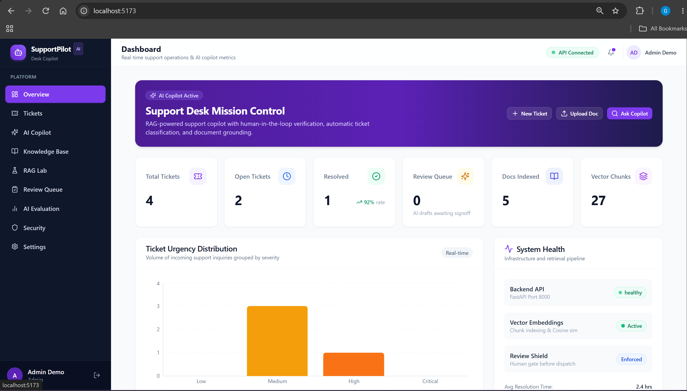
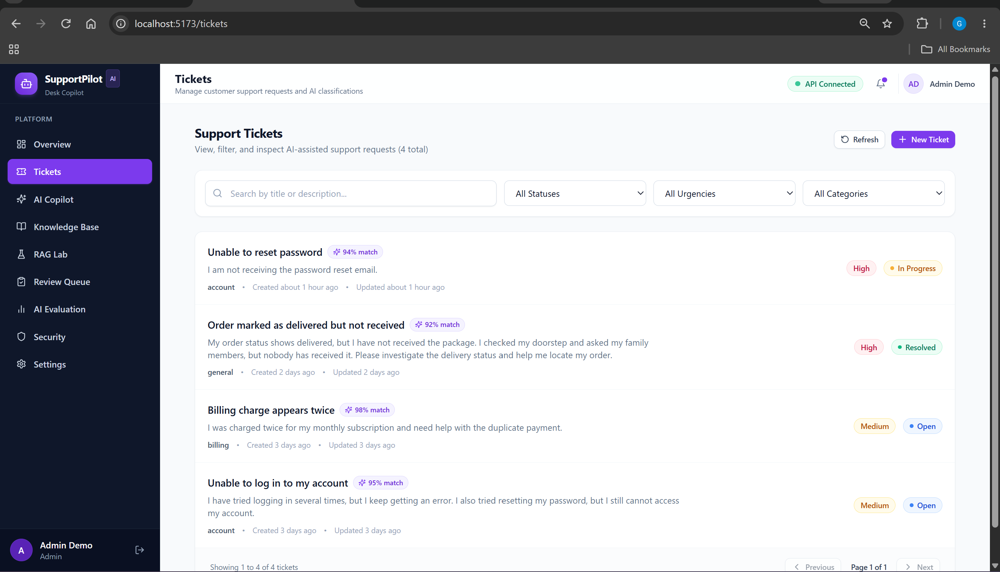
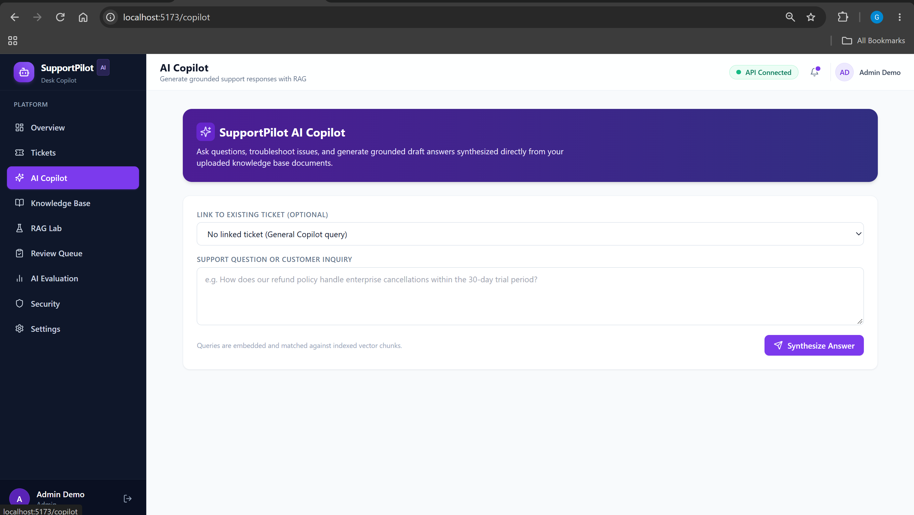
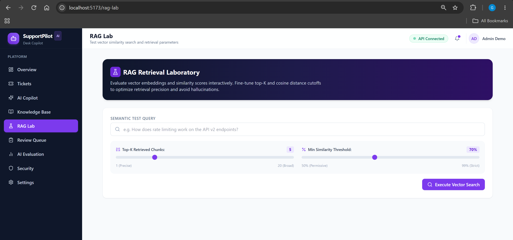
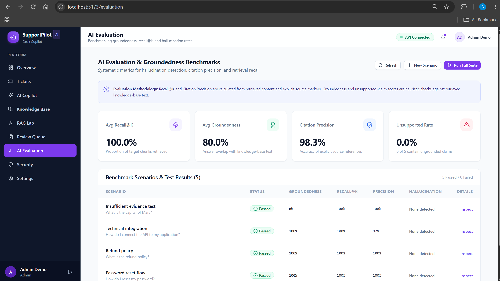

# SupportPilot — AI Support Desk Copilot

**An AI-powered support platform that helps support teams find relevant knowledge, draft grounded responses, and review AI-generated answers before they reach customers.**

SupportPilot is a full-stack application built around Retrieval-Augmented Generation (RAG), semantic search, human-in-the-loop approval, and AI evaluation. It combines a React frontend, FastAPI backend, PostgreSQL with pgvector, and Google Gemini to support knowledge-assisted customer service workflows.

> **Core principle:** AI assists the support agent; the agent remains in control of the final response.

## Table of Contents

- [Overview](#overview)
- [Key Features](#key-features)
- [How It Works](#how-it-works)
- [Architecture](#architecture)
- [Technology Stack](#technology-stack)
- [Application Screenshots](#application-screenshots)
- [AI and RAG Pipeline](#ai-and-rag-pipeline)
- [Security and Responsible AI](#security-and-responsible-ai)
- [Getting Started](#getting-started)
- [Environment Variables](#environment-variables)
- [Running Tests](#running-tests)
- [Project Structure](#project-structure)
- [Limitations and Future Improvements](#limitations-and-future-improvements)

## Overview

Customer support teams often need to search documentation, classify tickets, draft replies, and escalate issues that require human judgment.

SupportPilot brings these workflows together in one application.

The system retrieves relevant knowledge-base content, uses an AI model to generate context-grounded draft responses, and provides review workflows for approval, rejection, or escalation.

### What makes SupportPilot different?

- **Retrieval before generation:** Responses use retrieved knowledge-base passages instead of relying solely on a language model's general knowledge.
- **Traceable answers:** Draft responses include source citations to help agents verify supporting information.
- **Human-in-the-loop review:** AI-generated drafts are not automatically sent to customers.
- **Retrieval and answer evaluation:** Built-in evaluation workflows measure retrieval quality, groundedness, and citation precision.
- **Security-aware workflows:** Authentication, role-based access control, validation, and audit logging support safer operations.

## Key Features

### 1. Support Dashboard
- Ticket counts and status summaries.
- Urgency distribution and resolution statistics.
- Knowledge-base statistics.

### 2. Ticket Management
- Create, search, filter, and list support tickets.
- Track ticket status and assignment.
- Persist ticket changes in PostgreSQL.

### 3. AI Support Copilot
- Ask questions about customer-support issues.
- Retrieve relevant knowledge-base passages.
- Generate contextual response drafts with citations.
- Escalate questions when available evidence or confidence is insufficient.

### 4. Knowledge Base Ingestion
- Upload PDF, TXT, and Markdown documents.
- Extract text and split it into overlapping chunks.
- Generate embeddings and store them in pgvector.
- Track document ingestion status.

### 5. RAG Lab
- Explore semantic search results.
- Inspect retrieved chunks and similarity scores.
- Configure retrieval parameters such as top-k and similarity threshold.

### 6. AI Ticket Classification
- Classify ticket categories and urgency.
- Generate confidence and escalation recommendations.
- Validate structured AI outputs using Pydantic.
- Allow manual overrides.

### 7. Draft Review and Approval
- Generate AI-assisted response drafts.
- Edit, approve, reject, or escalate drafts.
- Preserve an audit trail of review actions.
- Keep approval separate from actual message delivery.

### 8. AI Evaluation
Evaluate retrieval and generated responses using:
- **Recall@K:** Whether relevant information appears in the retrieved results.
- **Groundedness:** Whether generated answers are supported by the available evidence.
- **Citation precision:** Whether citations appropriately support the answer.

Automatic evaluation scores are useful diagnostic signals; they should not be interpreted as proof that every answer is factually correct.

### 9. Security and Administration
- JWT-based authentication.
- Agent and admin roles.
- Input validation and audit logs.
- Prompt-injection-resistant handling of retrieved documents.

## How It Works

```text
             Support Agent
                  |
                  v
        React + TypeScript UI
                  |
                  v
          FastAPI Backend
                  |
          +-------+--------+
          |                |
          v                v
    Ticket Workflows   RAG Pipeline
                           |
                           v
                 Knowledge Base Search
                           |
                           v
                 PostgreSQL + pgvector
                           |
                           v
                   Retrieved Context
                           |
                           v
                  Google Gemini API
                           |
                           v
                 Cited Response Draft
                           |
                           v
                 Human Review Queue
                           |
                 +---------+---------+
                 |         |         |
                 v         v         v
               Approve   Reject   Escalate
```

*Actual response delivery requires a separate email integration.*

## Architecture

SupportPilot follows a frontend/backend architecture with a relational database and vector search.

| Layer | Technology | Responsibility |
|---|---|---|
| Frontend | React, TypeScript, Vite | User interface and support workflows |
| Styling | Tailwind CSS | Responsive UI styling |
| Backend | Python, FastAPI | API endpoints and application logic |
| ORM and migrations | SQLAlchemy, Alembic | Database access and schema migrations |
| Database | PostgreSQL 16 | Persistent application data |
| Vector search | pgvector | Semantic retrieval over document embeddings |
| AI generation | Google Gemini API | Answer drafting and ticket classification |
| Embeddings | `text-embedding-004` | Vector representations of knowledge-base text |
| Authentication | JWT, `python-jose`, `passlib` | Authenticated access |
| Testing | Pytest, HTTPX | Automated backend tests |
| Local infrastructure | Docker Compose | Local PostgreSQL and pgvector setup |

## Application Screenshots

Screenshots of the main SupportPilot workflows.

### Dashboard


### Ticket Management


### AI Copilot


### RAG Lab


### AI Evaluation


## AI and RAG Pipeline

The AI support workflow follows these steps:

1. **Document ingestion:** Extract text from supported knowledge-base files.
2. **Chunking:** Divide the text into overlapping chunks to preserve context across boundaries.
3. **Embedding generation:** Convert chunks into 768-dimensional vectors.
4. **Vector storage:** Store embeddings and associated content in PostgreSQL using pgvector.
5. **Semantic retrieval:** Retrieve relevant chunks using vector similarity and configurable retrieval parameters.
6. **Answer generation:** Provide the retrieved context to Gemini to generate a response.
7. **Citation and review:** Present a draft with supporting sources for agent verification.
8. **Evaluation:** Assess retrieval and response quality using the built-in evaluation workflow.

### Design decisions

- **Vector similarity search:** PostgreSQL and pgvector keep application data and vector retrieval within the same database system.
- **Overlapping chunks:** The configured chunk size and overlap help retain context across document boundaries.
- **Grounded generation:** Retrieved passages provide the evidence used to construct answers.
- **Abstention and escalation:** When sufficient evidence is unavailable, the system can avoid unsupported answers or recommend escalation.
- **Human approval:** Response generation and customer delivery are separate operations.

## Security and Responsible AI

SupportPilot incorporates several safeguards:

- **Authentication:** JWT-based authentication for protected workflows.
- **Role-based access control:** Agent and admin roles.
- **Input validation:** Pydantic schemas validate structured request and AI output data.
- **Prompt-injection resistance:** Retrieved document content is treated as untrusted data rather than as instructions that can override system behavior.
- **Backend authorization:** Document-level access checks are performed in the backend service layer.
- **Auditability:** Sensitive actions such as approval, rejection, escalation, and administrative changes are audit-logged.
- **Controlled delivery:** Generated drafts require a separate approval and sending workflow.

These safeguards reduce risk but do not eliminate every possible security or AI failure. Production use requires additional security testing and operational monitoring.

## Getting Started

### Prerequisites

Install the following:

- Python 3.11+
- Node.js 18+
- Docker Desktop
- A Google Gemini API key from [Google AI Studio](https://aistudio.google.com/)

### 1. Clone the repository

```bash
git clone https://github.com/sgeethika-05/SupportPilot.git
cd SupportPilot
```

### 2. Start PostgreSQL with pgvector

Ensure Docker Desktop is running.

```bash
docker compose up -d
```

This starts the database services defined in `docker-compose.yml`.

### 3. Configure the backend

Open a terminal in the project root:

```bash
cd backend
python -m venv .venv
```

Activate the virtual environment.

**Windows PowerShell:**

```powershell
.\.venv\Scripts\Activate.ps1
```

**macOS/Linux:**

```bash
source .venv/bin/activate
```

Install the dependencies:

```bash
pip install -r requirements.txt
```

Create your local environment file:

```powershell
Copy-Item .env.example .env
```

On macOS/Linux, use:

```bash
cp .env.example .env
```

Edit `backend/.env` and configure your database URL, a strong secret key, and Gemini API key.

Run the database migrations:

```bash
alembic upgrade head
```

Optionally, create demo data:

```bash
python scripts/seed_demo.py
```

Start the backend:

```bash
uvicorn app.main:app --reload --port 8000
```

Backend API: http://localhost:8000

Interactive API documentation: http://localhost:8000/docs

Health check: http://localhost:8000/api/health

### 4. Configure the frontend

Open a second terminal from the project root:

```bash
cd frontend
npm install
```

Create the frontend environment file:

```powershell
Copy-Item .env.example .env
```

On macOS/Linux:

```bash
cp .env.example .env
```

The default local API URL is:

```env
VITE_API_URL=http://localhost:8000
```

Start the frontend:

```bash
npm run dev
```

Open http://localhost:5173 in your browser.

### 5. Demo credentials

If you run the seed script, the project README configuration provides these demo accounts:

| Role | Email | Password |
|---|---|---|
| Admin | `admin@supportpilot.demo` | `demo1234` |
| Agent | `agent@supportpilot.demo` | `demo1234` |

These are for local demo use only. Do not use demo credentials in a production environment.

## Environment Variables

### Backend

| Variable | Purpose |
|---|---|
| `DATABASE_URL` | PostgreSQL connection string |
| `SECRET_KEY` | Secret used for JWT signing |
| `GEMINI_API_KEY` | Google Gemini API access |
| `ALGORITHM` | JWT signing algorithm; default `HS256` |
| `ACCESS_TOKEN_EXPIRE_MINUTES` | Token lifetime |
| `EMBEDDING_DIMENSIONS` | Embedding vector dimensions; default `768` |
| `DEFAULT_TOP_K` | Number of retrieved chunks; default `5` |
| `MIN_SIMILARITY_THRESHOLD` | Minimum similarity threshold; default `0.7` |

Refer to `backend/.env.example` for the complete configuration, including chunking and application settings.

### Frontend

| Variable | Purpose |
|---|---|
| `VITE_API_URL` | Backend API base URL; defaults to `http://localhost:8000` |

**Never commit real API keys, passwords, database credentials, or production secrets.** Use environment variables and the deployment platform's secret configuration.

## Running Tests

From the backend directory, activate the virtual environment and run:

```bash
pytest tests/ -v
```

To generate a coverage report, if pytest-cov is installed:

```bash
pytest tests/ -v --cov=app --cov-report=html
```

The test suite covers application areas including authentication, ticket workflows, documents, drafts, RAG, evaluation, dashboard behavior, and security.

## Project Structure

```text
SupportPilot/
├── backend/
│   ├── alembic/              # Database migrations
│   ├── app/
│   │   ├── api/routes/       # API route handlers
│   │   ├── core/             # Configuration and security
│   │   ├── db/               # Database session setup
│   │   ├── models/           # SQLAlchemy models
│   │   ├── schemas/          # Pydantic schemas
│   │   ├── services/         # AI, RAG, ingestion and evaluation
│   │   └── main.py           # FastAPI application
│   ├── scripts/              # Demo data utilities
│   ├── tests/                # Automated tests
│   ├── requirements.txt
│   └── .env.example
├── frontend/
│   ├── src/
│   │   ├── components/       # Reusable UI components
│   │   ├── context/          # Authentication context
│   │   ├── pages/            # Application pages
│   │   ├── services/         # API client
│   │   └── types/             # TypeScript definitions
│   ├── package.json
│   └── .env.example
├── docker-compose.yml
├── .gitignore
└── README.md
```

## Limitations and Future Improvements

The following integrations and capabilities are not fully implemented in the current version:

- **Email delivery:** Actual email sending requires an SMTP or SendGrid integration.
- **Real-time updates:** The current approach uses polling; WebSocket-based updates remain a potential improvement.
- **Single sign-on:** OAuth2/SSO integration is a future extension beyond the current JWT authentication.
- **Production deployment:** A production release requires environment-specific configuration, security testing, and deployment verification.

## Repository

**GitHub:** [sgeethika-05/SupportPilot](https://github.com/sgeethika-05/SupportPilot)

Built as a full-stack AI engineering project exploring retrieval-augmented generation, semantic search, human review workflows, and evaluation of AI-assisted support systems.

